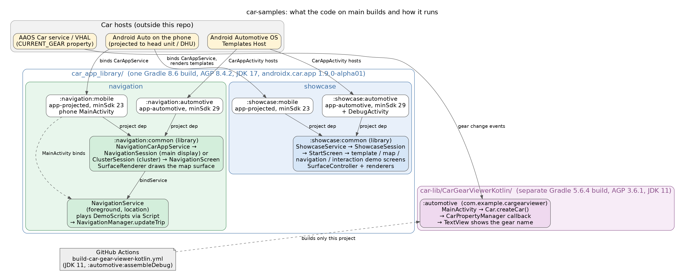

# Architecture

This page describes what the code on `main` builds and how it runs. The repository holds two
independent Android builds; nothing is shared between them.

The diagram source is [`diagrams/architecture.dot`](diagrams/architecture.dot) (Graphviz). After
editing it, run [`diagrams/render.sh`](diagrams/render.sh) to regenerate the PNG and SVG.

## Repository layout

| Path | What it is | Toolchain |
| --- | --- | --- |
| `car_app_library/` | One Gradle build with two Android for Cars App Library samples: `navigation` and `showcase` | Gradle 8.6 wrapper, AGP 8.4.2, Kotlin 2.0.0, JDK 17, compile SDK 34, `androidx.car.app` 1.9.0-alpha01 |
| `car-lib/CarGearViewerKotlin/` | A standalone Android Automotive OS (AAOS) app that reads the car's current gear | Gradle 5.6.4 wrapper, AGP 3.6.1, Kotlin 1.3.61, JDK 11, compile SDK 29 |
| `.github/workflows/build-car-gear-viewer-kotlin.yml` | CI: builds `car-lib/CarGearViewerKotlin` only, on pushes and pull requests to `main` | JDK 11 |
| `.devin/blueprint.yaml` | Devin environment setup (SDK, AAOS emulator image, `local.properties`) | — |

## `car_app_library/`: Car App Library samples

`settings.gradle` includes six modules. Each sample has the same three-module shape:

| Module | Type | Depends on | Runs on |
| --- | --- | --- | --- |
| `:<sample>:common` | Android library | `androidx.car.app:app` | — (all sample logic lives here) |
| `:<sample>:mobile` | Android app, minSdk 23 | `:<sample>:common`, `androidx.car.app:app-projected` | A phone; Android Auto projects it to the head unit or the Desktop Head Unit (DHU) |
| `:<sample>:automotive` | Android app, minSdk 29 | `:<sample>:common`, `androidx.car.app:app-automotive` | AAOS, hosted by the Templates Host through `CarAppActivity` |

The `mobile` and `automotive` apps of a sample share one `applicationId`
(`androidx.car.app.sample.navigation` or `androidx.car.app.sample.showcase`) and differ in
`versionCode` (114 for mobile, 113 for automotive). Both manifests declare the
`automotive_app_desc` metadata; only the automotive manifest requires the
`android.hardware.type.automotive` feature and declares `CarAppActivity`, the activity through
which the AAOS Templates Host shows the app.

### Runtime flow common to both samples

1. The car host (Android Auto or the AAOS Templates Host) binds the app's `CarAppService`.
2. `createHostValidator()` allows any host in debuggable builds and only the sample allowlist
   (`R.array.hosts_allowlist_sample`) in release builds.
3. `onCreateSession()` returns a `Session`; `Session.onCreateScreen()` returns the first `Screen`.
4. Screens return templates (list, grid, pane, message, map, navigation…); new screens are pushed on
   the `ScreenManager` stack and the host renders them.
5. Apps that draw a map register a `SurfaceCallback` with `AppManager` and draw on the surface the
   host gives them.

### `navigation`

- `NavigationCarAppService` returns a `ClusterSession` when the session is for the instrument
  cluster display, otherwise a `NavigationSession` (after creating its notification channel).
- `NavigationSession` owns the screen stack (`NavigationScreen`, search, favorites, route preview,
  settings, permission request) and a `SurfaceRenderer` that draws the map surface.
- `NavigationSession` binds `NavigationService`, a foreground location service. The service gets
  `NavigationManager`, registers a `NavigationManagerCallback`, plays a scripted route from
  `DemoScripts` through `Script` (a main-thread `Handler` that steps through `Instruction`s), and
  calls `NavigationManager.updateTrip()` so the host can show turn-by-turn info.
- `app/MainActivity` is a phone activity, launched from the mobile app, that also binds
  `NavigationService`.

### `showcase`

- `ShowcaseService` returns a `ShowcaseSession`, which starts at `StartScreen` (or a deep-linked
  screen when started from a navigation or result intent).
- `StartScreen` links to the demo groups: template layouts, user interactions, map demos,
  navigation demos and settings. Each group pushes further sample screens.
- `SurfaceController` draws on the map surface, switching between a default renderer and an
  override renderer chosen by the current demo.
- The automotive app adds a `DebugActivity`.

## `car-lib/CarGearViewerKotlin/`: AAOS gear viewer

A single app module, `:automotive` (`com.example.cargearviewer`, minSdk 28, target SDK 29).

1. `MainActivity.onCreate()` calls `Car.createCar(this)` and gets the `CarPropertyManager`.
2. It registers a `CarPropertyEventCallback` for `VehiclePropertyIds.CURRENT_GEAR`, which needs
   the `android.car.permission.CAR_POWERTRAIN` permission declared in the manifest.
3. `onChangeEvent()` maps the value (`0x1` neutral, `0x2` reverse, `0x4` park, `0x8` drive, else
   unknown) to a name and shows it in a `TextView`; `onErrorEvent()` only logs.
4. `onDestroy()` disconnects from `Car`.

On an AAOS emulator the gear can be changed with
`adb shell cmd car_service inject-vhal-event 289408001 <1|2|4|8>`.

## Build and CI

| Build | Command | CI |
| --- | --- | --- |
| Car App Library samples | `cd car_app_library && ./gradlew :showcase:mobile:assembleDebug :showcase:automotive:assembleDebug :navigation:mobile:assembleDebug :navigation:automotive:assembleDebug` (JDK 17) | Not built in CI |
| Gear viewer | `cd car-lib/CarGearViewerKotlin && ./gradlew :automotive:assembleDebug` (JDK 11) | `build-car-gear-viewer-kotlin.yml` |

Neither build has unit or instrumented tests.
